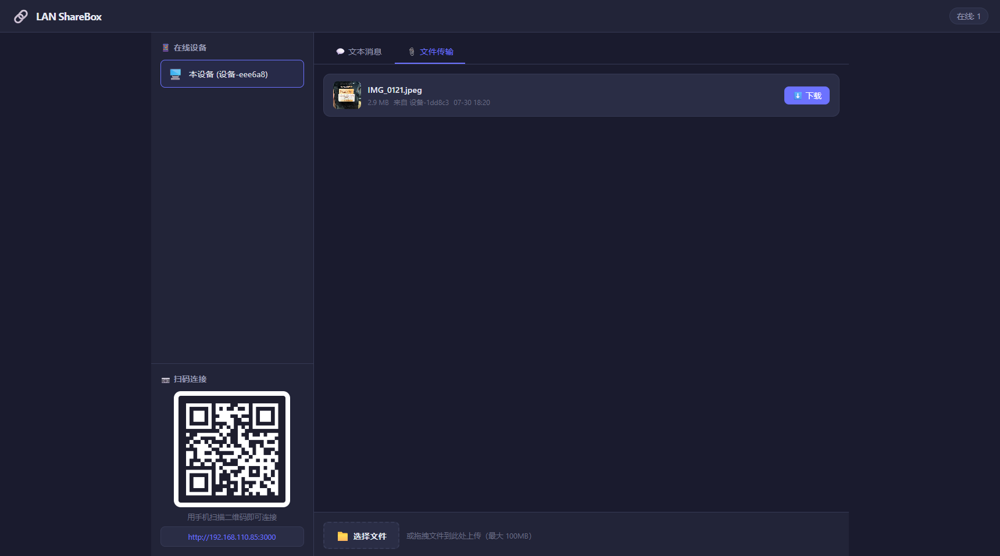
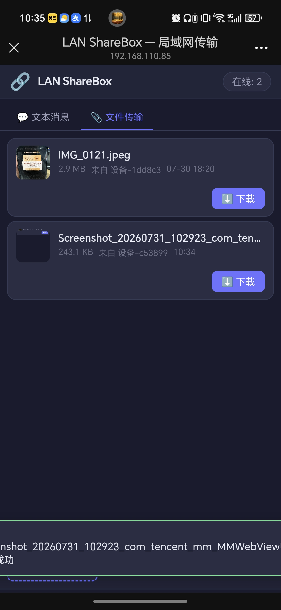

# 🔗 LAN ShareBox

> 局域网跨设备文本 / 文件传输工具 —— 电脑手机互传，扫码即用，无需联网，无需安装客户端。

一个轻量的本地网络共享工具。启动后在桌面端生成二维码，手机扫码即可加入同一页面，实现多设备之间实时共享**文本**与**文件**。所有数据只在你的局域网内流转，不经过任何第三方服务器。

---

## ✨ 功能特性

- 📷 **扫码即连** — 桌面端自动生成局域网地址二维码，手机一扫即可打开，无需手动输入网址
- 💬 **文本消息** — 实时同步文本内容，回车即发，适合在手机和电脑间复制粘贴长文本、链接、验证码
- 📎 **文件传输** — 支持点击选择或**拖拽上传**，上传后局域网内所有设备均可下载，单文件最大 100MB
- 📱 **在线设备列表** — 实时显示当前接入的设备，自动感知设备上线 / 离线
- 🔄 **实时同步** — 基于 Socket.IO，消息与文件变动在所有设备间即时推送
- 🖥️ **开箱即用** — 启动后自动打开浏览器；端口被占用时自动切换到下一个可用端口
- 🧹 **手动清理** — 页面右上角「🧹 清理」按钮，可按需清理文本 / 文件 / 全部；仅运行服务的本机可见与操作，手机等远端设备无此入口

---

## 📸 截图预览

| 💻 桌面端 | 📱 手机端 |
| --- | --- |
|  |  |

---

## 🛠️ 技术栈

| 能力 | 技术 |
| --- | --- |
| Web 服务 | [Express](https://expressjs.com/) |
| 实时通信 | [Socket.IO](https://socket.io/) |
| 文件上传 | [Multer](https://github.com/expressjs/multer) |
| 二维码生成 | [qrcode](https://github.com/soldair/node-qrcode) |
| 局域网 IP 探测 | [address](https://github.com/node-modules/address) |
| 唯一标识 | [uuid](https://github.com/uuidjs/uuid) |

数据均存储在**内存**与本地磁盘，不依赖任何外部数据库。

---

## 🚀 快速开始

### 方式一：下载安装包，双击即用（推荐）

到 [Releases](../../releases) 下载对应系统的文件，**无需安装 Node.js、无需 npm install**：

| 系统 | 文件 | 说明 |
| --- | --- | --- |
| Windows x64 | `LAN-ShareBox-Setup.exe` | 双击安装，创建开始菜单快捷方式，可勾选开机自启 |
| Windows x64 | `ShareBox.exe` | 免安装单文件版，双击直接运行 |
| macOS（Apple 芯片） | `LAN-ShareBox-arm64.dmg` | 打开后把 App 拖进 Applications |
| macOS（Intel） | `LAN-ShareBox-x64.dmg` | 同上 |

> ⚠️ Windows 首次运行会弹出防火墙提示，**必须点「允许访问」**，否则手机连不上。
> ⚠️ macOS 未做开发者签名，首次打开需 **右键 → 打开** 绕一次（Apple Gatekeeper 规则，无开发者账号时无解）。

### 方式二：从源码运行

#### 环境要求

- [Node.js](https://nodejs.org/) >= 18

#### 安装与运行

```bash
# 1. 安装依赖
npm install

# 2. 启动服务
npm start
```

启动成功后，终端会输出类似如下信息，并自动打开浏览器：

```
═══════════════════════════════════════════
  🔗  LAN ShareBox 已启动
═══════════════════════════════════════════
  本地访问: http://localhost:3456
  局域网:   http://192.168.x.x:3456
═══════════════════════════════════════════
```

> 💡 确保电脑与手机连接在**同一个 Wi-Fi / 局域网**下。

---

## 📖 使用说明

1. 在电脑上运行 `npm start`，浏览器会自动打开页面。
2. 用手机扫描页面左侧「扫码连接」中的二维码，手机即进入同一页面。
3. 切换顶部标签：
   - **💬 文本消息**：输入文本，回车或点击「发送」，内容会同步到所有设备。
   - **📎 文件传输**：点击「选择文件」或直接**拖拽文件**到上传区，上传完成后任意设备均可下载。
4. 左侧「在线设备」会实时显示当前接入的所有设备。
5. 需要清空数据时，在**运行服务的电脑**上点击右上角「🧹 清理」→ 弹窗会显示当前消息条数与文件总大小 → 选择清理文本 / 文件 / 全部；其中「全部清理」需额外输入确认词 **「确认」** 防止误触，仅本机可见使用，手机端无此入口。

---

## ⚙️ 配置

| 配置项 | 说明 | 默认值 |
| --- | --- | --- |
| `PORT` | 服务监听端口（环境变量）。若被占用会自动顺延到下一可用端口 | `3456` |
| 单文件大小上限 | 单个上传文件最大体积 | `100MB` |
| 消息保留数量 | 内存中保留的最近文本消息条数 | `50` |

通过环境变量指定端口启动：

```bash
# Linux / macOS
PORT=8080 npm start

# Windows (CMD)
set PORT=8080 && npm start

# Windows (PowerShell)
$env:PORT=8080; npm start
```

### 命令行参数

```bash
sharebox --port 8080       # 指定端口（默认 3456，占用时自动顺延）
sharebox --no-open         # 启动后不自动打开浏览器
sharebox --tray            # 驻留系统托盘（Windows），右键托盘图标可打开页面 / 打开数据目录 / 退出
sharebox --data-dir <path> # 指定数据目录
sharebox --autostart-install   # 设置开机自启（后台静默启动）
sharebox --autostart-remove    # 取消开机自启
sharebox --help
```

### 数据目录

上传的文件、文件元数据与历史消息不再保存在程序目录，而是统一放在系统用户数据目录，避免装到 `Program Files` / `Applications` 后因只读而崩溃：

| 系统 | 数据目录 |
| --- | --- |
| Windows | `%APPDATA%\ShareBox` |
| macOS | `~/Library/Application Support/ShareBox` |
| Linux | `~/.local/share/ShareBox` |

首次启动时，旧版本放在项目 `uploads/` 下的数据会自动迁移过来；也可以用 `--data-dir` 指定位置（把程序放在 U 盘时，在 exe 同级建一个 `data` 目录即自动进入便携模式）。

---

## 📁 项目结构

```
myShareBox/
├── server.js              # 入口：CLI 参数、Express + Socket.IO、核心业务逻辑
├── src/                   # 桌面端能力
│   ├── data-dir.js        # 数据目录解析与旧数据迁移
│   ├── tray.js            # Windows 托盘驻留（PowerShell / WinForms，无原生模块）
│   └── autostart.js       # 开机自启（注册表 / LaunchAgents / autostart）
├── scripts/
│   ├── make-icon.js       # 生成 app.ico / app.icns（纯 Node，无依赖）
│   ├── make-mac-app.js    # 把二进制包装成 macOS .app
│   └── tray.ps1           # 托盘菜单脚本
├── installer/
│   ├── setup.iss          # Inno Setup 安装包脚本
│   └── start-hidden.vbs   # 后台静默启动（不弹控制台黑窗）
├── public/                # 前端静态资源
│   ├── index.html
│   ├── app.js
│   └── style.css
├── uploads/               # 旧版本数据目录（首次启动后自动迁移到用户数据目录）
├── package.json
└── .gitignore
```

---

## 📦 打包分发

用 [pkg](https://github.com/yao-pkg/pkg) 把 Node 运行时、依赖和静态资源打进单个可执行文件：

```bash
npm run build:icon    # 生成 assets/app.ico 与 app.icns
npm run build:win     # → dist/ShareBox.exe
npm run build:mac     # → dist/ShareBox-macos-arm64 / -x64
```

推送 tag 后 GitHub Actions 会自动完成双平台构建并发布 Release：

```bash
git tag v1.1.0 && git push origin v1.1.0
```

产出物：

| 平台 | 产物 |
| --- | --- |
| Windows | `ShareBox.exe`、`LAN-ShareBox-Setup.exe`（Inno Setup 安装包） |
| macOS | `LAN-ShareBox-arm64.dmg`、`LAN-ShareBox-x64.dmg` |

> macOS 必须在 macOS 环境（或 GitHub Actions 的 macos runner）上构建：
> Apple 芯片拒绝运行未签名的 arm64 二进制，Windows 上交叉构建无法完成签名。
> CI 中会做 ad-hoc 签名（`codesign -s -`），能正常在本机运行；
> 若要彻底消除 Gatekeeper 拦截，需要 Apple 开发者账号做签名 + 公证。

---

## ⚠️ 说明与限制

- 本工具面向**可信局域网**环境使用，服务本身不带有任何身份鉴权，请勿暴露在公网。
- 上传文件存储于服务端本地磁盘，启动时**不再自动清空**；需要时由本机在页面上点击「🧹 清理」手动删除。
- 文本消息保存在内存中，进程重启后不保留；上传的文件及元数据持久化到磁盘，重启后自动恢复。
- 大文件传输受限于单文件 1GB 上限（HTTP 上传，不受 Socket.IO 缓冲区限制）。
- Windows 托盘依赖系统 PowerShell 与 .NET WinForms；服务以 `--tray` 启动时若环境不支持会自动降级为普通运行，不影响服务本身。

---

## 📄 License

[MIT](./package.json)
